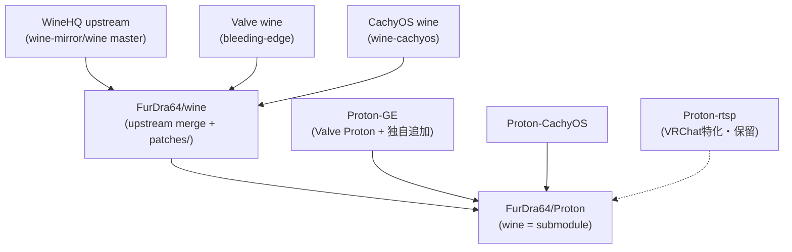
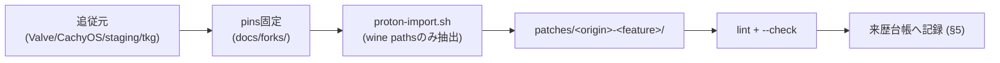

# Fork追従戦略（企画書）

人間向けの全体像。機械向け詳細は `docs/VALVE-TRACKING.md`、`docs/forks/README.md`、`patches/README.md` を参照。
Status: 構想段階（Wave 0〜1 完了、取り込みは未着手）。

## 1. 確定構成

| 方向 | 意味 | 状態 |
|---|---|---|
| WineHQ → wine | upstream masterへ毎日FF | 稼働中（upstream-sync.yml） |
| Valve → wine | bleeding-edgeを12群として移植済み | 完了（c0608aa12ab）、MFはHOLD |
| CachyOS → wine | wine-cachyosから選別して摘む | 未着手（方針：forkせず摘む） |
| wine → Proton | submodule参照 | 未着手 |
| GE/CachyOS/rtsp → Proton | GE土台＋差分方式（§4） | 未着手 |

## 2. 候補ソースの分類

| fork | URL | 分類 | 理由 |
|---|---|---|---|
| wine-staging | github.com/wine-staging/wine-staging | 摘み取り向け | 現役（約270 patch、2週毎rebase）。実験集として監視必須 |
| wine-tkg-git | github.com/Frogging-Family/wine-tkg-git | 摘み取り向け | staging＋Valve＋GE用hotfix集。baseには不安定 |
| Lutris wine | github.com/lutris/wine | 対象外 | 2023-09以降停滞。独自価値なし |
| Kron4ek builds | github.com/Kron4ek/Wine-Builds | 対象外 | 独自patchなしの再ビルド。検証用 |
| Proton-rtsp | github.com/SpookySkeletons/proton-rtsp | 保留 | VRChat特化で汎用性なし。需要が出たら再評価 |

## 3. 摘み取りフロー（wine側）

原則：

- 丸ごとforkせず、patch単位で摘む（CachyOS方式と同型）
- 大物は追従元参照＋差分保持、小物は `patches/` 直置き
- 取り込みは人間レビュー必須（CI自動importはしない）

## 4. Proton側の方針（推奨）

**GEを土台にし、Valve追従は手動rebaseで行う。**

理由：

- GE = 最新bleeding-edge Proton Experimental ＋ 独自追加（MF・FSR・NTSync等）
- GE自体がValveの下流＋αなので、GE追従だけでValveの大半が付いてくる
- 土台をValve Proton直にするとGE独自分を毎回拾い直す手間が発生する
- GEの遅延部分だけValveから直接摘めばよく、全面手動より安い

運用：GEの更新を検出（drift）→ 差分レビュー → 取り込み。Valve直摘みはGE遅延分のみ。

## 5. パッチ来歴台帳（設計）

「どのwine/Protonから何を移植したか」を `docs/PATCH-LEDGER.tsv` に記録する。
列：`patchset / origin / source-ref / imported-date / upstream-status / notes`

- `origin`：`own`（独自）、`valve`、`ge`、`cachyos`、`staging`、`tkg` のいずれか
- `source-ref`：SHAまたはtag。`own` は `-`
- 新規patchset追加時は台帳行の追加を必須とする（将来lint化）
- `definition` の `Author`/`Upstream-Status` と二重管理にしない：台帳が正本

## 6. ビルド方針（確定）

- **WoW64・SLRコンテナ・64bit一本**（CachyOSの `/main` 側のみ）
- 32bit別ビルドなし（WoW64で32bitアプリ動作）
- ビルド週次、追従検出のみ毎日。ローカル負荷ゼロ（全てGitHub Actions）

## 7. 未決事項

- [ ] CachyOSのpin基準（ブランチ固定 or 日付追従）
- [ ] GE/rtspの最終選定（rtspは保留中）
- [ ] 取込レビューの粒度（patchset単位 or fork更新単位）
- [ ] 台帳lint化の時期（Wave 2以降）

## 8. 追加候補（2026-11-12調査）

| fork | URL | 分類 | 理由 |
|---|---|---|---|
| Proton-Wineland | github.com/nanomatters/proton-salkim | base候補/摘み取り | Wayland集中。週次リリースで現役。Proton運用ならbase候補、wine側には摘み取り |
| DW-Proton | dawn.wine/dawn-winery/dwproton | 摘み取り | Proton-CachyOS＋EM＋独自修正の完成品。土台にせず摘む |
| Proton-Tkg | github.com/Frogging-Family/wine-tkg-git（内proton-tkg/） | 摘み取り | ビルドシステム。patchset摘み取り用 |
| Proton-EM | github.com/Etaash-mathamsetty/Proton | 摘み取り | winewayland/HDRの元栓。CachyOS経由で間接取得が安い場合多 |
| Wine-Tkg | 同上wine-tkg-git | 摘み取り | staging除外/調整の捌き方が参考になる |

## 9. wine-stagingを土台にする案の是非

結論：**土台は変えず、stagingは摘み取り元の筆頭に据える。**

- stagingはforkではなく「upstream開発版へのpatchset」（約275〜290件、2週毎rebase、保守はほぼ単騎）
- こちらのupstream master毎日FFが「完全追従」に相当するため、staging検討の前提は満たしている
- 全面採用は非推奨：実験280件をValve 12群の上に載せると衝突面が跳ね上がり、単騎保守のrebase遅延リスクも抱える
- 運用：stagingのrebaseをdrift検出の対象に加え、必要分だけ摘む（tkgの捌き方を参照）
