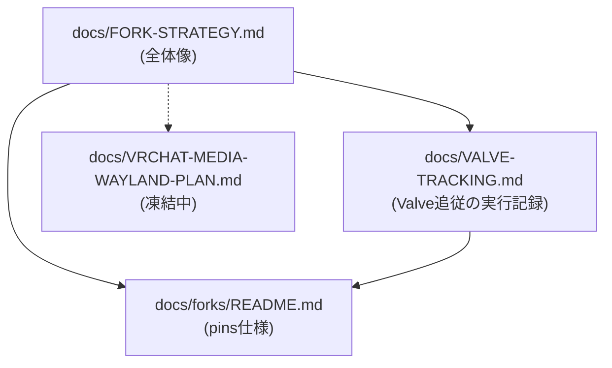

# PLANS — 計画文書の索引

本文の転載なし。詳細は各文書の正本を読む。この索引は案内のみ。

| 文書 | 1行説明 | 状態 |
|---|---|---|
| `docs/FORK-STRATEGY.md` | WineHQ追従＋下流摘み取り＋Proton方針の全体像 | 有効 |
| `docs/VALVE-TRACKING.md` | Valve bleeding-edge追従のpin運用と移植実績の記録 | 有効 |
| `docs/VRCHAT-MEDIA-WAYLAND-PLAN.md` | VRChat向けメディア再生とWayland対応の手順案 | 凍結 (wine側の目処待ち) |
| `docs/forks/README.md` | 複数fork共通のpins.conf仕様とresolver手順 | 有効 |

## 相互関係

読み順: `FORK-STRATEGY.md`で全体像を掴み、`VALVE-TRACKING.md`と`forks/README.md`で追従作業に入る。`VRCHAT-MEDIA-WAYLAND-PLAN.md`は凍結中のため、着手判断が出るまで読むだけでよい。
